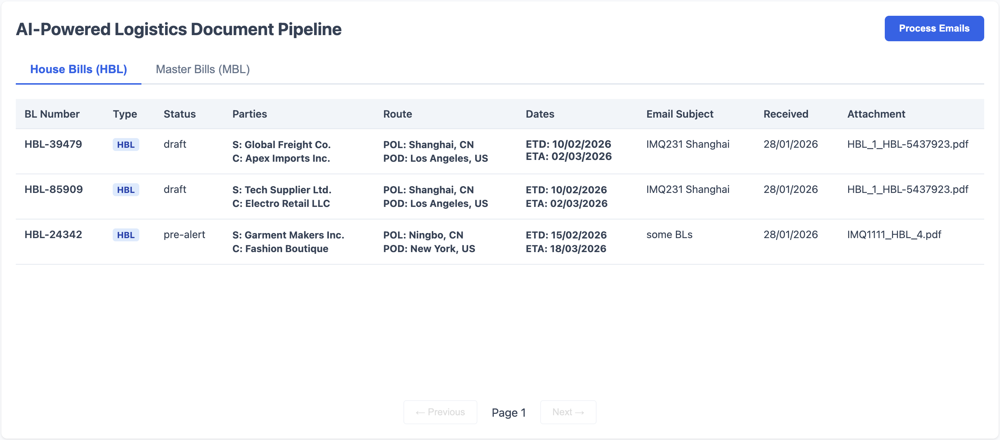

# AI-Powered Logistics Document Pipeline

A full-stack pipeline, automating the extraction of operational data from emails and complex bills.



## How to Run Locally

This section covers setting up and running both the backend and frontend services on your local machine.

### Prerequisites

- **Python 3.11+** (for backend)
- **Node.js 20+ & pnpm** (for frontend)
- **GCP Project Credentials**: This is provided in backend/credentials folder. However, you can check the Gmail and Firestore Setup below.
- **Anthropic API Key** for AI extraction; set via `.env` (Provided)

### Backend Setup

#### 1. Install Python Dependencies

1. Create a Python environment (Optional, but recommended)

```bash
cd backend
python3 -m venv venv

# for macOS/Linux
source venv/bin/activate

# for Windows
venv\Scripts\activate
```

2. Install the packages

```bash
pip install -r requirements.txt
```

#### 2. Environment Variables Is Configured

#### 3. Run Backend Server

Make sure you are still in the `backend` directory and run:

```bash
fastapi dev src/main.py
```

The API will be available at `http://localhost:8000`.

**First Run:** On the first execution of the `/process` endpoint, the Gmail auth script will pop open your browser. Sign in with the Gmail account provided and authorize the app. The token is saved and reused automatically.

### Frontend Setup

#### 1. Install Node Dependencies

```bash
cd frontend
pnpm install
```

If you don't have `pnpm`, install it via:

```bash
npm install -g pnpm
```

#### 2. Frontend API Endpoint is Configured as Environment Variable

#### 3. Run Development Server

make sure you are still in the `frontend` directory and run:

```bash
pnpm dev
```

The frontend will start (usually) at `http://localhost:5173` (or another port if 5173 is in use; it will be shown).

### Integration: Full Local Workflow

1. **Start Backend:**

    ```bash
    cd backend
    source venv/bin/activate
    fastapi dev src/main.py
    ```

2. **Start Frontend (in another terminal):**

    ```bash
    cd frontend
    pnpm dev
    ```

3. **Open Frontend in Browser:**
   Navigate to `http://localhost:5173`

4. **Trigger Processing:**
   Click the "Process" button in the UI.

5. **View Results:**
    - `GET /hbl`: Click HBL tab
    - `GET /mbl`: Click MBL tab
    - You can check logs in both backend terminal and browser console.

## Credential Setups

### Gmail Setup

In a professional setting (G-Suite / Google Workspace), we would use a Service Account. This is a special "robot" account that uses a key file to authenticate instantly with organization email via API, with zero human interaction.

For a standard free Gmail account (@gmail.com), there is no way to get credentials purely via an API call without a human interaction to authenticate. For this project, we used this method. Also, since the program will read specifically from one targeted Gmail account, we will not use the `Sign in with Google` method for getting the authentication key. Therefore, we have left with one options: Getting the authentication token automatically using a script that prompt us to authenticate via the browser. This method is the one we used.

You can follow the below steps or the steps at the official documentation: [https://developers.google.com/workspace/gmail/api/quickstart/python](https://developers.google.com/workspace/gmail/api/quickstart/python)

#### Here is how the second method will work

1. We run a script locally (i.e `backend/src/gmail_auth.py`). It opens a browser, we sign in to targeted Gmail account and click "Allow". Then, we will save the authentication token in an `auth_token.json` file.

2. Our backend uses that `auth_token.json` forever (it automatically refreshes itself).

#### How we can do it?

Go to the Google Cloud Console (console.cloud.google.com) and select your project.

##### A. Configure the Consent Screen in GCP project

1. In left sidebar, go to APIs & Services > OAuth consent screen

2. In `User Type`, select External to allow anyone (Internal is only for emails within a organization/company).

3. Click `Create`. Then give the app a name and a customer support email.

4. You might also be asked to provide a developer email so GCP team can contact you regarding this auth.

##### B. Create OAuth Credentials

1. Go to APIs & Services > Credentials.

2. Click `CREATE CREDENTIALS` at the top and select OAuth client ID.

3. Application Type: Select Desktop App (Because we are running a script that needs to pop up a browser window once).

4. Give it a name and your email for GCP team to contact you.

5. Click Create.

6. Download the JSON file. Rename it to `auth_credentials.json` and put it in the backend folder.

##### C. Add Test Users

- Since our app is "External" and unverified, it will only work for emails we allowed called `Test Users`.

1. In left sidebar, go to APIs & Services > OAuth consent screen > Audience.

2. Under `Test users`, click `Add Users` and type the exact email address(s) we want to access its inbox.

### Setup Firestore

Here is how to set up Firestore entirely from the Google Cloud Console.

#### 1. Enable Firestore in Your Existing Project

1. Go to the Google Cloud Console.

2. In the top-left dropdown, select the project you created for the Gmail API.

3. In the top search bar, type "Firestore" and select "Firestore" (under Products & Pages).

4. Click `Create a Firestore database`

5. Give it a `Database Id` (i.e name).

6. Select `Standard Edition`

7. Under Modes, Select `Firestore in Native mode` and in Security rules, select `Restrictive`

8. Under location, select Multi-region or any region is close to where backend is hosted.

9. Finally Click `Create Database`

#### 2. Handle Authentication (The Credentials)

You must create a Service Account that your backend can use to communicate with the database.

1. In the Google Cloud Console, from the left sidebar (click on hamburger menu), go to "IAM & Admin" > "Service Accounts".

2. Click "Create Service Account".

3. Give it a name (e.g., firestore-backend).

4. Access/Role: In the "Grant this service account access to project" step, search for and select "Cloud Datastore User" (this gives read/write access to Firestore).

5. Once created, from the list, click on that new Service Account in column called `email`.

6. Go to the "Keys" tab > "Add Key" > "Create new key".

7. Select JSON and click Create.

8. Rename the downloaded file to `firestore-service-account.json` and put it in `backend/credentials` folder.
